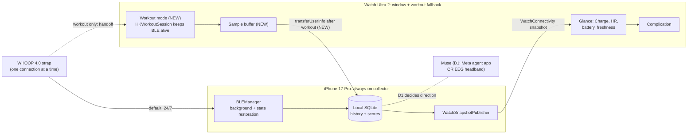

# NOOP on iPhone + Apple Watch Ultra, always connected, plus Muse

- **Plan revision:** r2, 2026-10-24. r1 was approved by the user on 2026-10-24 with D1 = (a), D2 = (a), D3 = (a).
- **Status:** approved, implementing. r2 records the decisions and the concrete R6 design (see "Revision r2").
- **Repo:** `~/noop`, `main` at `37b660a` (v2.8.6), upstream `NoopApp/noop`, plus uncommitted watch work from 2026-06-17.

## Problem statement

The user wants to stop paying for a WHOOP membership. To do that, NOOP has to cover what the official app covers day to day:

1. Running on their own iPhone 17 Pro and Apple Watch Ultra 2, not only the Mac.
2. Staying connected to their WHOOP 4.0 strap all the time, so history keeps building without them opening the app.
3. Being glanceable from the wrist.
4. Connecting to "Muse". What that means is not settled yet (see D1).

**Facts found (verified):**

- The strap on record is a **WHOOP 4.0**. The Mac NOOP database lists one device, "WHOOP 4.0", with about 40k HR samples and 11k R-R intervals.
- The working tree already has an **uncommitted watch app**: a watch target, a complication, iPhone-to-watch snapshot sync, and a "Start Live" direct-to-strap mode. It is about 1,360 lines plus project changes.
- That work **builds**. With signing disabled, `xcodebuild -scheme NOOPiOS` succeeded and embedded `NOOPWatch.app` inside `NOOP.app/Watch`.
- The iPhone app already declares `bluetooth-central` background mode and uses Core Bluetooth state restoration, so the phone can keep the strap connected in the background.
- The WHOOP 4.0 exposes the standard heart-rate characteristic (0x2A37). NOOP's code notes it "works unbonded". So the watch can read live HR and R-R from it directly.
- The strap holds **one Bluetooth connection at a time**, per the repo's protocol docs. Phone and watch cannot both be connected at once.
- Xcode on this Mac has two signing teams: a **paid company team** ("RevitalizedAI LLC", whose profiles last 365 days) and a **free Personal Team**. The iPhone 17 Pro is paired and available. The Watch Ultra 2 shows as "unavailable" right now; it must be unlocked, on the charger, and near the Mac or phone to install.
- The app installed as `/Applications/Muse.app` is **Meta's "Muse" agent app** (`com.meta.endo`, an internal Meta build). It is **not** the Interaxon Muse EEG headband app. It supports MCP servers.

**Gaps in the existing watch work (found in review):**

- Watch direct mode stops whenever the watch app leaves the foreground. Wrist-down kills it, so it is not "always connected".
- HR collected by the watch is shown but never sent back to the phone. Workouts recorded by the watch leave a hole in history.
- The watch UI says "Recovery". The app renamed that score to **Charge** in v2.6.0.
- Bundle IDs are `com.noopapp.*`. Signing under either of the user's teams needs a team-unique prefix.

**Assumptions:** watchOS limits background Bluetooth for third-party apps. A running `HKWorkoutSession` is the supported way to keep a watch app (and its Bluetooth link) alive with the wrist down. This comes from Apple docs and forum answers but has not been tested on this watch. It also needs the HealthKit entitlement, which free Personal Teams are widely reported not to get. The R4 spike verifies this first.

## Proposed solution overview

Make the **iPhone the always-on collector** and the **watch the window**. The phone holds the strap connection 24/7 in the background, stores everything, and computes scores. The watch shows Charge, live HR, battery, and data freshness from the phone, with a watch-face complication. For workouts away from the phone, the watch takes over the strap through a workout session that survives wrist-down. It hands the samples back to the phone afterwards, so history has no gap. Then sign everything under one team and install it on both devices, with a runbook so re-installs are repeatable.

Muse integration is designed only after D1 is answered.

### Visual overview

*Solid lines: the normal path, mostly existing code. Dotted lines: the workout handoff and Muse, which are new. "NEW" marks what this plan adds.*

## Decisions (resolved at G1)

| ID | Question | Options | Recommendation |
|---|---|---|---|
| D1 | Which "Muse"? | **(a)** Meta's Muse agent app on this Mac. NOOP would expose read-only summaries to it through a local MCP server. **(b)** The Interaxon Muse EEG headband. NOOP would pair to it over Bluetooth and record meditation/EEG sessions next to HRV. | Ask. These are unrelated projects. (a) sends health summaries into a Meta prototype app, which breaks NOOP's "nothing leaves the device" promise. (b) reverse-engineers a second device protocol, which is bigger. |
| D2 | Which signing team? | **(a)** Paid "RevitalizedAI LLC" team: 1-year profiles, HealthKit, App Groups. **(b)** Free Personal Team: re-sign every 7 days, likely no HealthKit, so no workout mode and no Apple Health. | (a), if it is acceptable to put a personal app under the company account. (b) breaks "always connected" every 7 days and blocks R4. |
| D3 | Where does the code go? | **(a)** A private fork under `vnguyendc`, with a PR inside that fork. **(b)** A PR to upstream `NoopApp/noop`. **(c)** A local branch only. | (a). The bundle-ID and team changes are personal and do not belong upstream. A clean watch PR can go upstream later. |

## Revision r2 (2026-10-24, after approval)

- **D1 = (a):** Meta's Muse agent app. **D2 = (a):** the RevitalizedAI LLC team. **D3 = (a):** a private repo under `vnguyendc`. GitHub does not allow a fork of a public repo to be private, so this is a private copy of upstream, not a GitHub "fork".
- **R6 mechanism changed from a local MCP server to Apple Health.** Inspecting Muse 9.0 (`com.meta.endo`) showed no way to register a local stdio MCP server. Its "custom connectors" are API-key or OAuth cloud services, and its local connectors are built in. It does ship an **Apple Health connector**, and its own UI text says: "Apple Health is only on iPhone. Open the app on your iPhone to connect or manage it." NOOP's iPhone app already writes daily resting HR, HRV (SDNN), SpO₂ and respiratory rate into Apple Health, deduplicated per day. So R6 becomes: sign with HealthKit (D2), turn on NOOP's Apple Health write-back, connect Muse's Apple Health connector on the iPhone, and confirm Muse answers from NOOP-written data. No new server code. This narrows scope and adds no new data path beyond the one the user chose in D1.
- **R6 limitation:** Charge, Effort and Rest have no Apple Health type, so Muse will not see those scores directly. It sees the underlying vitals plus the Apple Watch's own data.

## Context

- **Classification:** feature (watch companion completion + install), plus configuration (signing), plus an integration (Muse, scope pending D1). Severity: not a defect. Urgency is set by when the user wants to cancel.
- **Inspected:** README, `docs/IOS.md`, `docs/BUILD.md`, `project.yml` and its diff, every uncommitted watch file, the `BLEManager` background and standard-HR paths, the CHANGELOG, the Mac NOOP database (a read-only copy), Xcode teams and profiles, connected devices, and the Muse app bundle.
- **External research:** Apple program-enrollment and capabilities pages. Neither states Personal Team limits for HealthKit or App Groups. Third-party reports say Personal Teams get 7-day profiles and up to 10 App IDs per 7 days, without HealthKit. watchOS extended-runtime and workout-session references cover background Bluetooth. Muse headband protocol references are community-made (muse-js, muse-lsl, muse-rs).
- **UI/UX research limit:** Mobbin returned "requires a paid plan" and Refero was not reachable. The watch UI follows Apple's watchOS HIG for glanceable single-metric screens and complication families, plus the existing NOOP design tokens in `StrandDesign`. No competitor screenshots were compared.
- **Out of scope:** WHOOP 5.0/MG specifics, App Store or TestFlight distribution, Android, changing the scoring math, and any upstream release.
- **Subscription risk (for the user, not code):** export the WHOOP CSV before cancelling and import it into NOOP. After cancelling, keep the official app from updating the strap firmware, because a firmware update can reset pairing (NOOP shows a re-pair guide when that happens). Using third-party apps may conflict with WHOOP's terms. That is the user's call.

## Requirements and acceptance criteria

| ID | Requirement | Acceptance criteria |
|---|---|---|
| R1 | Signed install on both devices | NOOP launches on the iPhone 17 Pro and NOOPWatch launches on the Watch Ultra 2, both signed by the D2 team. The profile expiry date is recorded. |
| R2 | Phone stays connected in background | With the app backgrounded and the phone locked for 2 h or more, new HR samples keep landing in the store. After a Bluetooth toggle or the strap going out of range and back, it reconnects without opening the app. |
| R3 | Watch glance + complication | The watch shows Charge, live HR, battery, and "updated N min ago" from the phone. It flags stale data after 15 min. The complication renders in circular, inline, and rectangular families. The copy says "Charge", not "Recovery". |
| R4 | Watch workout mode survives wrist-down | Starting a workout on the watch takes over the strap (the phone disconnects), records HR and R-R, and keeps receiving with the wrist down for 30 min or more. Ending it hands the strap back to the phone, which reconnects. Without HealthKit (D2 = b), the UI says workout mode is unavailable rather than failing silently. |
| R5 | Watch samples reach phone history | After a watch workout, its HR and R-R samples appear in the phone store within 1 min of the watch reaching the phone. Re-delivery creates no duplicates. Tests cover the encode/decode and dedupe logic. |
| R6 | Muse can read NOOP data | With the D2-signed build, NOOP's Apple Health write-back succeeds (no `lastError`), and NOOP-sourced resting HR, HRV, SpO₂ and respiratory rate samples appear in Apple Health. After connecting Muse's Apple Health connector on the iPhone, Muse answers a question about recent HRV or resting HR with values matching NOOP. |
| R7 | Repeatable install runbook | `docs/plans/` or `docs/IOS.md` gains steps to re-sign and re-install on both devices, including how to bring the watch online for Xcode. |
| R8 | No regressions | Existing package tests and the macOS + iOS builds still pass. The upstream bundle-ID default is unchanged for other builders (team and bundle overrides sit in a local, git-ignored config). |

## Design

- **Signing (R1, R8):** add `Config/Local.xcconfig` (git-ignored) with `DEVELOPMENT_TEAM` and `BUNDLE_ID_PREFIX`. `project.yml` then uses `$(BUNDLE_ID_PREFIX)` for the 4 bundle IDs, the App Groups, and `WKCompanionAppBundleIdentifier`, defaulting to `com.noopapp`. This avoids hard-coding the user's team into shared files. *Alternative:* edit the IDs in place on a personal fork. That is simpler but leaks into any upstream PR.
- **Phone background (R2):** no new mechanism is planned. The existing restoration and auto-rescan get verified on device. Fixes happen only if R2 fails.
- **Watch workout mode (R4):** replace "Start Live" with "Start Workout". It starts an `HKWorkoutSession` (activity type `other`), then the existing `WatchDirectBLEClient`. The `scenePhase` auto-stop is removed while a session runs. The existing `WatchDirectHandoffCoordinator` already disconnects and reconnects the phone. *Alternative:* `WKExtendedRuntimeSession`. Rejected because its session types are time-capped and do not fit open-ended workouts.
- **Sample hand-back (R5):** the watch buffers `(timestamp, bpm, rr[])` in memory. Every 60 s, and on workout end, it sends batches with `WCSession.transferUserInfo`, which the system persists and delivers once the phone is reachable. *(r2 note: the buffer is not written to a file. A watch-app crash can lose up to the last 60 s of samples. That is disclosed as P3.)* The phone inserts through existing `WhoopStore` insert paths, keyed on timestamp, so duplicates are dropped. The codec lives in `StrandiOSShared` so the iOS test target can test it.
- **UI (R3, R4):** keep the current single-scroll layout. Rename the score to Charge. Make the primary action one full-width button. Show workout state with elapsed time, large HR, R-R count, and battery. Use the system green/yellow/red Charge bands the app already uses.
- **Muse (R6):** use NOOP's existing Apple Health write-back plus Muse's iPhone Apple Health connector. No code change unless verification finds a write-back defect.

## Task breakdown

| # | Task | Depends on | Likely files | Reqs | Verification seam |
|---|---|---|---|---|---|
| T1 | Branch and fork per D3. Commit the existing watch work as its own commit. | D3 | git | R8 | Clean build as found |
| T2 | Local signing override and parameterized bundle IDs | D2 | `project.yml`, `Config/Local.xcconfig`, `.gitignore` | R1, R8 | Signed build for device |
| T3 | Spike: HKWorkoutSession + BLE with wrist down on the real watch | T2 | `StrandWatch/*` | R4 | 30 min on-wrist test |
| T4 | Workout mode + HealthKit entitlement on the watch | T3 | `StrandWatch/*`, `project.yml` | R4 | Unit tests (reducer) + device |
| T5 | Watch sample buffer, codec, phone ingest with dedupe | T4 | `StrandiOSShared/WatchSamples.swift`, `StrandiOS/Watch/*`, tests | R5 | Unit tests + device |
| T6 | Watch UI copy and polish (Charge, workout state) | T4 | `WatchGlanceView.swift`, `NOOPWatchWidget.swift` | R3 | Screenshots on the watch and simulator |
| T7 | Install on both devices; 2 h background soak on the phone | T2 | none | R1, R2 | Device logs + store row counts |
| T8 | Muse via Apple Health: enable write-back, connect Muse on iPhone | T7 | none expected | R6 | Health app shows NOOP as source; Muse answer matches |
| T9 | Runbook | T7 | `docs/IOS.md` | R7 | Follow it from a clean state |

## Validation and delivery

- **Implementation checks:** `swift test` in the 5 packages, the `NOOPiOSTests` target, and builds for the `Strand` (macOS), `NOOPiOS`, and `NOOPWatch` schemes.
- **Independent behavior checks (verifier):** R1 to R5 on the real iPhone 17 Pro and Watch Ultra 2 with the user's WHOOP 4.0. The user has to wear the watch for the R4 soak and keep the strap nearby for R2. Simulator screenshots alone do not count for R3.
- **UI/UX review:** `frontend-skill` + `frontend-design` review of the watch glance, workout, and complication screens, using rendered screenshots.
- **Delivery:** a PR per D3 (default: a private fork, `feat/watch-always-connected` into the fork's `main`). No upstream PR, merge, or release without separate approval. Upstream CI (`app-build.yml`, `swift-packages.yml`) runs only if D3 = b.
- **Risk to watch:** if T3 shows watchOS drops the strap link with the wrist down even inside a workout session, R4 falls back to "watch live view while the app is open". The phone stays the 24/7 collector either way.

## Task and evidence record (updated during implementation)

- **Stage:** implementation done and self-reviewed. Verification is **blocked** on device signing (see Blockers).
- **Branch:** `feat/watch-always-connected` from `37b660a`. The June watch work is commit `1fbb607` and this plan is `9f07c10`. Later changes sit on top of those.
- **Not in the candidate:** `Strand/Resources/Localizable.xcstrings` has an uncommitted Xcode re-extraction diff from before this task. It is left untouched and unstaged.

### Checks run

| Check | Result |
|---|---|
| `NOOPiOSTests` (iPhone 17 Pro simulator) | 22 tests, 0 failures. Covers sample batching and dedupe, the phone's 10-minute watch timeout, stale-message drop, app-group fallback, and the reconnecting state. |
| `swift test` in the five packages | WhoopProtocol 156, WhoopStore 93, StrandAnalytics 213, StrandImport 88, StrandDesign 19. All pass. |
| `xcodebuild` NOOPiOS (device, unsigned) and Strand (macOS) | Both build. |
| Simulator: Ultra 3 (49 mm) watch paired with an iPhone 17 Pro | The phone-to-watch snapshot sync works. Not-synced, synced-empty, Bluetooth-failed and workout-permission states were rendered and inspected. |
| Signed device build (`-allowProvisioningUpdates`) | **Blocked.** Xcode error: "Unable to log in with account 'vnguyendc@gmail.com'. The login details … were rejected." No signing identity is in the keychain. |

### UI/UX review (frontend-skill + frontend-design, applied to watchOS)

- **Approach:** one dominant number per screen (Charge on the glance, heart rate in the workout), utility copy, NOOP green as the single accent, and red only for the destructive action.
- **Fixed during review:**
  - The ring label was truncated ("Char…") and duplicated the heading. The label was removed.
  - The watch and complication showed an invented Charge of 72 before the first sync. They now show dashes and "Open NOOP on your iPhone to sync."
  - "End workout" inherited the green tint. It is now red.
  - **P1:** a Bluetooth failure hid the live screen while the phone stayed disconnected. The screen now follows the session, with "Search again" and "End workout".
- **Not yet seen rendered:** the connected heart-rate reading, the scanning list and the elapsed timer. The simulator has no Bluetooth, and the workout permission sheet needs a tap. These are covered on device.
- **Evidence:** screenshots in the session scratchpad: `01-glance-not-synced.png`, `02-glance-synced.png`, `03-workout-start.png`, `05-live-bluetooth-failed.png`.

### Independent review, round 1 (feature-dev code-reviewer agent; reads code only, cannot run it)

Findings and resolutions:

- **P1:** the phone's 10-minute timeout can't run while iOS has the app suspended after hand-off. **Fixed.** Once the watch holds the strap (or after a 25 s grace), the phone arms a pending Bluetooth connect to the known strap (`BLEManager.awaitStrapReturn`). The system completes it in the background the moment the watch lets go, for any reason.
- **P2:** an out-of-order start or stop across the three delivery channels. **Fixed.** Changes are timestamped, and anything not newer than the last applied change is ignored.
- **P2:** heartbeats kept flowing while the watch never held the strap. **Fixed.**
  - Heartbeats are sent only while connected.
  - A watch watchdog hands the strap back after 3 minutes without it.
  - On first use, the watch auto-picks a strap when it is the only WHOOP in range.
- **P2:** the phone skipped disconnecting when it was mid-reconnect. **Fixed.** It always lets go.
- **P2:** no reconnect after a Bluetooth power cycle. **Fixed.**
- **P2:** `stop()` could miss the live peripheral after a rescan. **Fixed.**
- **P2:** an orphaned workout session after a watch-app relaunch. **Fixed** with a recovery handler that ends it.
- **P3s fixed:**
  - The value is copied in the Bluetooth callback.
  - Main-thread access is fixed in the snapshot store.
  - The post-workout snapshot no longer claims the iPhone holds the strap.
  - An immediate restart after End now works.
  - The macOS targets are pinned to no team.
- **Also found while fixing:** the phone lacked the reply-less `didReceiveMessage` delegate, so the watch's wake-up messages were dropped. **Fixed.**
- **Accepted P3s:**
  - The watch buffer is memory-only.
  - The phone ingest task has no background assertion.

### Independent review, round 2 (same reviewer, on the fixed tree)

- **P1:** after a fresh phone launch, the phone let go of the strap but did not count itself as wanting it back. **Fixed.** The phone is the 24/7 collector, so it always reclaims the strap after a watch session.
- **P2:** the phone never passed its Bluetooth restore identifier, so `willRestoreState` was dead code and a pending connect died if iOS terminated the app. **Fixed.** The identifier is now passed on iOS only, as `docs/IOS.md` already specified. This is the riskiest change in the candidate, because it switches on a restore path that has never run. Device check R2 must cover it.
- **P2:** a queued notice from an earlier session could arm the fallback early. **Fixed.**
- **P2:** a failed pending connect was never retried. **Fixed** with a 3 s retry, skipped when the bond was wiped.
- **P2:** the phone could win the strap after a watch link blip, and the watch was never told. **Fixed.** The phone now messages the watch, which ends its workout and shows why.
- **P3s fixed:**
  - The pending connect no longer touches a live link.
  - The watch ignores callbacks for a strap released by a rescan.
  - The grace check fits the background time iOS grants.
- **Accepted P3s:**
  - On first use, if the user takes more than 25 s to pick a strap that isn't auto-picked, the phone may take it back first.
  - First-use name-based auto-pick was **removed** after an automated security review: a spoofed "WHOOP" device could inject readings. The first connection is a tap, and only that user-picked strap is reconnected automatically.
- **Checks after round 2:**
  - `NOOPiOSTests`: 28 tests, 0 failures.
  - The iOS + watch and macOS builds succeed with no new warnings.

### Blockers

1. **Re-sign in to Xcode** (Settings → Accounts → vnguyendc@gmail.com). Only the user can do this. It blocks R1, R2, R4, R5 on device, and R6.
2. **Watch reachability:** the Watch Ultra 2 shows "unavailable" to Xcode. It must be unlocked, on its charger near the phone, with Developer Mode on.
