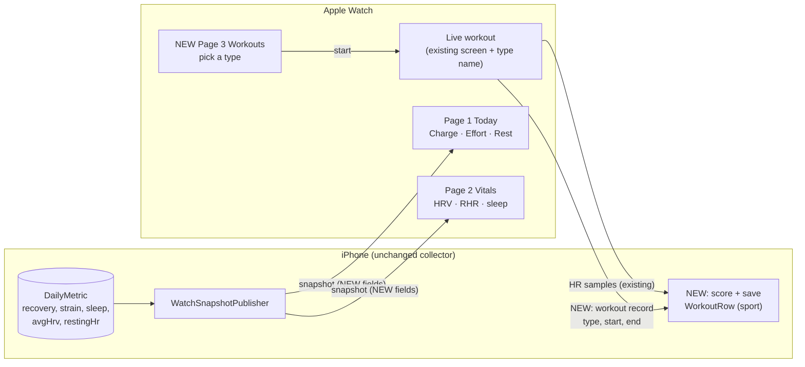

# Apple Watch: today's scores, vitals, and workout types

Revision: v5
Status: Implemented and verified on simulators (2026-10-29); PR delivery in progress
Project / repository: `~/noop` (NOOP iPhone + Apple Watch)
Builds on: `feat/watch-always-connected` at `f606279` (includes the r4 Apple Health commit) (plan `2026-10-24-iphone-watch-install-and-muse.md`, r4)
PR target: new private repo `vnguyendc/noop` (D2 = a), `main`

## Problem statement

The user wants to open NOOP on their Apple Watch and see today's Charge (recovery), Effort (strain), and Rest (sleep) scores, plus HRV and resting heart rate. They also want to pick a workout type before starting a workout.

What the watch does today (verified by reading the code):

- The watch shows **Charge only**, with live HR, strap battery, and data freshness (`StrandWatch/WatchGlanceView.swift`).
- The phone sends a small `WatchSnapshot` with `recovery`, `bpm`, `batteryPct`, `bonded`, `updated` (`StrandiOSShared/WatchSnapshot.swift`). Effort, Rest, HRV, and resting HR never leave the phone, though the phone has all of them in `DailyMetric` (`strain`, `avgHrv`, `restingHr`, `totalSleepMin`) and computes Rest with `AnalyticsEngine.Rest.composite(daily:)`.
- "Start workout" always starts an `HKWorkoutSession` with `activityType = .other` (`StrandWatch/WatchWorkoutController.swift`). There is no type choice.
- A watch workout **creates no workout entry on the phone**. The watch sends its HR and R-R samples back, so history has no gap, but the Workouts list only gets whatever the phone's bout detector later finds, labelled "detected". So even if the watch offered a type, nothing would record it.

Naming: NOOP calls its scores **Charge, Effort, Rest**, all 0–100 (renamed from Recovery, Strain, Sleep in v2.6.0). The watch will use those names. "Sleep score" in the request maps to Rest.

## Proposed solution overview

Turn the watch app into three vertically paged screens, scrolled with the Digital Crown:

1. **Today:** one large Charge ring, with Effort and Rest as two smaller rings beside it, then live HR, strap battery, and freshness under them.
2. **Vitals:** HRV, resting HR, and last night's sleep time.
3. **Start a workout:** a list of workout types. Tapping one starts a workout of that type. The last type used moves to the top.

Optional (R12, drop it if you prefer): when a workout ends, a short "Workout saved" screen shows the type, the elapsed time, and the average HR before the app returns to Today.

The phone sends the extra numbers in the existing snapshot. When a workout ends, the watch sends a small record (type, start, end) to the phone. The phone scores it from the HR samples the watch already sent and saves it in the Workouts list under that type, the same way a workout started on the phone is saved.

Out of scope: saving workouts to Apple Health (see D1), trends or charts on the watch, new complications, swimming, GPS or distance, and any change to the live workout screen beyond showing the chosen type.

## Visual overview



Caption: the phone keeps doing all storage and scoring. New items are the extra snapshot fields, the Workouts page, and the end-of-workout record that becomes a typed entry in the phone's Workouts list.

Watch wireframes (45 mm, approximate):

```
 Page 1: Today          Page 2: Vitals          Page 3: Workouts
┌──────────────────┐   ┌──────────────────┐   ┌──────────────────┐
│ Today      10:09 │   │ Vitals     10:09 │   │ Start a    10:09 │
│  ╭────╮  ◯48 Eff.│   │ HRV              │   │ ▸ Strength Train.│ ← last used
│  │ 72 │          │   │ 64 ms            │   │ ▸ Running        │
│  ╰────╯  ◯85 Rest│   │ Resting heart rate│  │ ▸ Walking        │
│  Charge          │   │ 52 bpm           │   │ ▸ Cycling        │
│ ♥ 58 bpm  ▮ 84%  │   │ Sleep            │   │ ▸ HIIT           │
│ Synced 3 min ago │   │ 7h 12m           │   │ ▸ Rowing, Yoga   │
│                 •│   │                 •│   │ ▸ Other          │
└──────────────────┘   └──────────────────┘   └──────────────────┘
        Digital Crown / swipe up-down moves between pages
```

Mocks (Apple Watch Ultra 49 mm and 41 mm at 2×, plus the live workout, optional saved screen, never-synced state, and the pass-1 equal-ring layout for comparison): https://claude.ai/artifact/AkAf8cDr67r42tgHb7nYTM

## Context, research, and triage

- **Classification:** feature (watch UI + a small phone/watch data contract change). Not a defect. No urgency beyond the user's goal of replacing the WHOOP app.
- **Inspected:** `StrandWatch/*` (all 5 files), `StrandiOSShared/WatchSnapshot.swift`, `StrandiOS/Watch/WatchSnapshotPublisher.swift`, `Strand/App/AppModel.swift` (`endWorkout`), `Strand/Data/Repository.swift` (`saveManualWorkout`), `Strand/Screens/TodayView.swift` (metric names and formats), `Strand/Screens/WeeklyDigestView.swift` (Rest score source), `WhoopStore` (`DailyMetric`, `WorkoutRow`, `upsertWorkouts`, `hrSamples`), `project.yml` (watchOS 10 target, so `.verticalPage` is available).
- **Verified:** workout upserts are keyed on (device, start, sport), so a record delivered twice saves once. The Workouts screen already uses the sports list Running, Walking, Cycling, Strength Training, Swimming, Rowing, Yoga, HIIT.
- **Inferred, not verified:** the bout detector skips a detected bout that overlaps a real workout (`IntelligenceEngine.swift:169`, from the code comment), so a typed watch workout should not also show as "detected". Verification checks this.
- **Swimming excluded:** the strap's live HR comes over Bluetooth, which does not carry through water, so a swim session would record nothing. `HKWorkoutSession` swimming also needs extra configuration.
- **r4 work** (Apple Health connect card) is now committed as `f606279`. This task builds on it and does not touch those files.
- **Decisions:** D1 = (a) NOOP only, D2 = (a) create a private repo. The user answered both on 2026-10-28.

### Decisions needed at G1

| ID | Question | Options | Recommendation |
| --- | --- | --- | --- |
| D1 | Should watch workouts also be saved to Apple Health? | **(a)** No. NOOP's Workouts list only, as today. **(b)** Yes, with `HKLiveWorkoutBuilder`. The watch's own sensors then also record HR and calories, and Activity rings get credit. | **(a)** for this task. (b) is a bigger change (more Health permissions, a second HR source, possible duplicates with NOOP's own Health write-back) and can follow as its own plan. |
| D2 | Where does the PR go? The 2026-10-24 plan chose a private repo under `vnguyendc`, but none exists yet (checked `gh repo list` today) and `origin` is the public upstream `NoopApp/noop`. | **(a)** Create a private repo `vnguyendc/noop`, push `main` and the branches, PR there. **(b)** Local branch only for now. | **(a)**, on approval. Creating the repo is an outward action, so it needs your yes. |

## UI/UX research and analysis

- **User and task:** one person, glancing at the wrist in the morning ("am I recovered?") and starting a workout with one or two taps.
- **Sources inspected (2026-10-29):** Mobbin website, signed in by the user. Their Pro plan has expired, so each search shows only its first 4 screens, and the Mobbin connector still refuses. Mobbin has no watchOS screens, so the references are iPhone screens and widgets. Three searches: "whoop" (settings and trends only, not relevant), "recovery score sleep score dashboard", and "choose workout type". Apple's HIG pages render client-side and returned no text, so they were not read.

| Inspected reference | Observed pattern | Fit and tradeoffs | Decision |
| --- | --- | --- | --- |
| [WHOOP widgets](https://mobbin.com/screens/eb710c39-dc18-4cd5-954d-d71b96c42519) | Three rings in one row (Sleep 61%, Recovery 47%, Strain 6.6), the value inside each ring, a small label under it, one colour per score | The closest match to page 1, and it already works at widget size, which is about a watch screen | **Adapt**: rings with the value inside and the label beside or below, but with Charge larger than Effort and Rest. The morning question is "how recovered am I", and three equal rings gave equal weight to a score that accumulates all day (Effort) and one from last night (Rest). Pass 1 (equal rings) stays on the canvas for comparison. Colours as on the phone: Charge on the recovery gradient (red, amber, gold, green), Effort on the strain ramp (gold, orange, rose, magenta), Rest purple `#A879FF` |
| [Google Health (Fitbit)](https://mobbin.com/screens/73e15280-37c9-4596-93ac-97d307a92814) | "Your recovery signals": resting HR (51 bpm) and HRV (71 ms) as two tiles, each with a 7-day mini chart and an "In range" tag | Confirms grouping RHR and HRV on their own. The weekly chart and range tag need history and baselines on the watch | **Adapt** as a separate Vitals page with big value, unit and label. **Defer** the chart and range tag (not asked for, needs more data sent) |
| [Cal AI "Log Exercise"](https://mobbin.com/screens/ddb6649e-2c74-44e4-9f79-25c774f5bc85) | Short list of exercise types, each a full-width row with an icon, a name, and a one-line hint | Big tap targets and a short list suit the watch. The hint line doesn't fit at 41 mm | **Adopt** full-width rows with icon and name. **Drop** the hint line |
| [BitePal workout search](https://mobbin.com/screens/6a460c3f-14b9-4bb7-8c4c-c7a27e2a3e82) | Long searchable list with an icon per type | Search is for dozens of types; NOOP offers 8, and typing on a watch is slow | **Reject** search; keep 8 items, last used first |
| NOOP iPhone Today screen (`TodayView.swift:366`) | Charge, Effort, Rest tiles, then HRV and Resting HR | Same names and order, so nothing to relearn | **Adopt** names, order and colours |
| Dense single scrolling screen (alternative) | Everything on one scroll | Start workout falls below the fold and the scores lose focus | **Reject** in favour of vertical pages (`TabView(.verticalPage)`, watchOS 10+) |

Screenshots stay out of the repo (Mobbin content); the links above point to the inspected screens.

## Requirements and acceptance criteria

| ID | Requirement | Observable acceptance criterion |
| --- | --- | --- |
| R1 | The watch shows today's Charge, Effort, and Rest, each 0–100. | On a watch synced with the phone, page 1 shows three values that equal the phone's Today tiles for the same day (Charge and Effort rounded to whole numbers; Rest equal to the phone's Rest score). |
| R2 | The watch shows HRV, resting HR, and last night's sleep time. | Page 2 shows HRV in ms, resting HR in bpm, and sleep as `Xh Ym`, matching the phone's Today tiles. |
| R3 | Missing values are explicit. | A metric the phone doesn't have shows "–", never 0. With no snapshot at all, page 1 says "Open NOOP on your iPhone to sync." |
| R4 | Old and new apps keep working together. | A snapshot from the old phone build (no new fields) decodes on the new watch with Charge shown and the rest "–". A new snapshot decodes on the old watch. Covered by unit tests. |
| R5 | The user picks a workout type, and the watch starts a workout of that type. | Page 3 lists Running, Walking, Cycling, Strength Training, HIIT, Rowing, Yoga, Other. Tapping one opens the live screen with that name in its header, and the `HKWorkoutSession` uses the matching activity type. |
| R6 | The last type used is listed first. | After a Cycling workout, Cycling is the first row the next time page 3 opens, including after an app relaunch. |
| R7 | A finished watch workout appears on the phone under its type. | After a watch workout of at least 2 minutes with the strap connected, the phone's Workouts list shows one entry with that sport, the watch's start and end time, avg/max HR, Effort, and calories, and no separate "detected" entry for the same span. |
| R8 | Delivery is safe to repeat and out of order. | A workout record delivered twice saves one entry. A record arriving before its HR samples are stored still gets scored from those samples (phone processes watch messages in order). A workout with fewer than 2 HR samples saves nothing, as phone-started workouts do today. |
| R9 | Existing behaviour is unchanged. | Strap handoff, the no-strap 3-minute timeout, End workout, and the complication behave as before. Existing tests pass. |
| R11 | Page 1 follows the inspected ring pattern with Charge as the lead. | A large Charge ring with the value inside and the label below; Effort and Rest as smaller rings beside it with the value inside and the label to the right; coloured as on the phone (Charge recovery gradient, Effort strain ramp, Rest purple). Sleep on the Vitals page uses the palette cyan `#2FC7FF`. Matches the mocks. |
| R12 (optional) | Ending a workout confirms it. | After End, a "Workout saved" screen shows the type, elapsed time, and average HR from the watch's live samples for a few seconds or until tapped, then returns to Today. Drop this row at approval to leave it out. |
| R10 | Accessible and legible. | Each gauge and metric has a VoiceOver label with name, value, and unit. Text fits a 41 mm screen at default size without truncating score labels. |

## Design

**Shared (`StrandiOSShared`)**
- `WatchSnapshot`: add optional `effort`, `rest`, `hrvMs`, `restingHr`, `sleepMin`. Synthesized `Codable` decodes missing optionals as nil, which gives R4. Keep `recovery` as the stored name to stay compatible with old builds.
- New `WatchWorkoutKind` enum: display name, phone sport string, `HKWorkoutActivityType`, SF Symbol. "Other" maps to sport "Workout", matching the phone's own manual workouts.
- New `WatchWorkoutRecord` (sport, start, end) plus transport helpers next to `WatchSnapshotTransport`, sent with `transferUserInfo` so it survives the phone app being asleep.

**Phone (`StrandiOS`, `Strand`)**
- `WatchSnapshot.make(from:)`: fill the new fields from today's `DailyMetric` (`repo.days.last`), with Rest from `AnalyticsEngine.Rest.composite(daily:)`. Use the latest day that has each value, as `recovery` already does.
- Move the scoring in `AppModel.endWorkout` (avg/max HR, `StrainScorer`, calories) into one function so the phone's own workouts and watch workouts score the same way.
- `WatchSnapshotPublisher`: handle `WatchWorkoutRecord` by reading HR samples for that span (`hrSamples`), scoring, and upserting a `WorkoutRow` with source `manual`. Run sample batches and workout records through one ordered chain of tasks so a record never scores before its samples are stored (R8).

**Watch (`StrandWatch`)**
- `WatchGlanceView` becomes a `TabView(.verticalPage)` with Today, Vitals, Workouts. The live screen stays as is while a workout runs, with the type name in the header.
- `WatchLiveModel.start(kind:)` passes the kind to `WatchWorkoutController.start(kind:)` (sets `activityType`) and remembers it in `UserDefaults` for R6. `stop()` flushes samples first (existing) and then sends the record, so the phone receives them in that order.

**Alternatives considered**
- *Watch scores the workout itself.* Rejected: the watch lacks the user's profile (max HR, weight, sex) and would duplicate the scoring code.
- *Send recent days of history to the watch for trends.* Rejected for now: not asked for, and larger WatchConnectivity payloads.

**Risks**
- The phone may be asleep when the record arrives. `transferUserInfo` queues it and wakes the app in the background; scoring then needs the store, which already handles "store not ready" by logging. A dropped record loses only the label, not the HR data. Verification checks a record sent while the phone app is in the background.
- Three gauges at 41 mm are tight. Verified on the smallest simulator.

## Task stewardship

No Obsidian note or Linear issue is linked to this watch work in the existing plan, and none is proposed. The evidence record lives in this plan.

## Task breakdown

| Task | Requirements | Dependencies / likely files | Verification |
| --- | --- | --- | --- |
| 1. Worktree `feat/watch-today-and-workouts` from `f606279` | – | git worktree | Clean build of `NOOPiOS` |
| 2. Extend `WatchSnapshot`; add `WatchWorkoutKind`, `WatchWorkoutRecord`, transport | R4, R5, R8 | `StrandiOSShared/WatchSnapshot.swift`, new `WatchWorkout.swift` | Unit tests: old/new decode, kind mapping, record round-trip |
| 3. Phone fills new snapshot fields | R1, R2, R3 | `StrandiOS/Watch/WatchSnapshotPublisher.swift` | Unit test on a fixture `DailyMetric` |
| 4. Shared workout scoring; phone saves watch workouts in order | R7, R8 | `Strand/App/AppModel.swift`, `WatchSnapshotPublisher.swift` | Unit test: record before samples, duplicate record, <2 samples |
| 5. Watch pages: Today, Vitals, Workouts; type in live header; remember last type | R1–R3, R5, R6, R10 | `StrandWatch/WatchGlanceView.swift`, `NOOPWatchApp.swift`, `WatchWorkoutController.swift` | Simulator screenshots, 41 mm and 49 mm |
| 6. Self-review, UI/UX review (frontend-skill + frontend-design), fixes | all | – | Zero P0/P1 |
| 7. Verify on simulators, then on the user's devices via TestFlight | R1–R10 | Paired iPhone + Watch simulators; TestFlight build | Evidence table in this plan |
| 8. Deliver per D2 | – | – | PR link, checks |

## Validation and delivery

- **Implementation checks:** `NOOPiOSTests` (iPhone simulator), `swift test` for touched packages, `xcodebuild` for `NOOPiOS` and `NOOPWatch`.
- **Behavioural checks:** paired iPhone and Watch simulators with a seeded database, comparing watch pages with the phone's Today screen (R1–R3). A simulated workout record via the existing DEBUG launch flags to check R7–R8 on the phone. Real strap behaviour (R7 end to end) needs the user's devices: a TestFlight build, then one short workout of a chosen type. That step depends on the user and is reported separately from simulator evidence.
- **UI review:** screenshots of all three pages and the live screen at 41 mm and 49 mm, empty and stale states, VoiceOver labels; reviewed with both frontend skills.
- **Workspace:** new worktree off `f606279`, leaving the main checkout (and its uncommitted `Localizable.xcstrings` change) untouched.
- **Delivery:** PR per D2. No CI runs on a private repo unless workflows are enabled there. No merge or release without separate approval.

## Approval record

- 2026-10-28: the user answered "d1: no just noop. d2: let's create a private repo." Recorded as D1 = (a), D2 = (a).
- 2026-10-29: v3 adds the Mobbin research (user signed in) and R11.
- 2026-10-29: v4 links the mocks and fixes the Effort colour (strain ramp, not cyan).
- 2026-10-29: v5, second design pass after rendering the mocks: Charge becomes the large ring with Effort and Rest beside it; small watchOS-style page titles; page 3 titled "Start a workout"; Vitals sleep colour from the palette; live screen drops the device-name line and words the R-R count as "Recording, N beats"; optional R12 saved screen.
- 2026-10-29: plan v5 approved by the user ("approved"), R12 included.
- 2026-10-29: implemented and verified on simulators; PR https://github.com/vnguyendc/noop/pull/2 (base `feat/watch-always-connected`, stacked on PR #1, in the private repo `vnguyendc/noop`, which already existed; no new repo was created). Awaiting G4 review. Not merged.
- 2026-10-29: TestFlight build 54 (NOOP Vinh, com.vnguyendc.noop) uploaded from `f95dc0a` with `Tools/testflight.py`, processed, released to the internal group. Device check of the typed-workout save is with the user.

## Implementation record

- **Workspace:** worktree `/Users/vinhnguyen/noop-watch`, branch `feat/watch-today-and-workouts`, base `f606279`.
- **Shared:** `WatchSnapshot` gains optional `effort`, `rest`, `hrvMs`, `restingHr`, `sleepMin` (old keys unchanged); `updatedText()` now reads "Synced …". New `WatchWorkout.swift`: `WatchWorkoutKind` (8 kinds, sport names, SF Symbols, last-used in `UserDefaults`), `WatchWorkoutRecord` (sport, start, end, id), `WatchWorkoutTransport`, and `OrderedInbox` (runs queued work in arrival order).
- **Phone:** `WorkoutScoring.row(...)` is the one scoring path for phone-started and watch workouts (`AppModel.endWorkout` now calls it). `WatchScoreValues(days:)` picks the latest day with each value, with Rest from `AnalyticsEngine.Rest.composite(daily:)`. `WatchSnapshotPublisher` fills the new snapshot fields, routes sample batches and workout records through one `OrderedInbox`, and saves a watch workout as a `manual` row under its sport (`saveWatchWorkout`). One log line per received transfer and per save.
- **Watch:** `WatchGlanceView` is a `NavigationStack` > `TabView(.verticalPage)` with `WatchTodayPage`, `WatchVitalsPage`, `WatchWorkoutsPage` (`WatchPages.swift`), rings and colour ramps in `WatchScoreRing.swift`, and `WatchSavedWorkoutView` for R12. `WatchLiveModel.start(kind:)` sets the session's activity type, remembers the kind, and tracks the average HR; `stop()` flushes samples, then queues the record, then hands the strap back. The live header shows the kind and a yellow timer; the R-R count reads "Recording, N beats".
- **Simulator seams (DEBUG only):** watch `-NOOPDemoSnapshot`, `-NOOPStartPage`, `-NOOPAutoStartKind`, `-NOOPDemoReadings`, `-NOOPAutoStopAfter`, `-NOOPDemoSaved`; phone `-NOOPSimulateWatchWorkout` (replays samples, record, duplicate record through the receive path).
- **Self-review:** three passes over the diff. Fixed on the way: the 40 mm screen wrapped "Effort" and truncated "Strength Training" (labels now scaled and fixed-size, names allowed two lines); the ring colours now blend between stops like the phone instead of snapping to the nearest stop; `WorkoutScoring` was missing `import WhoopProtocol`.

## Verification evidence (2026-10-29)

| Check | Result |
| --- | --- |
| `NOOPiOSTests` on iPhone 17 Pro simulator | 44 tests, 0 failures: the 35 existing plus `WatchSnapshotTests` (new fields round-trip, old-phone JSON decodes with new fields nil, new JSON keeps old keys: R4) and `WatchWorkoutTests` (kinds and sports, last-used ordering and persistence, record round-trip and validity, `OrderedInbox` arrival order: R5, R6, R8). |
| `StrandTests/WorkoutScoringTests` (macOS) | **Written, not run.** The macOS test bundle does not build in this checkout: its files `@testable import Strand` but the app module is `NOOP`, and xcodegen writes no test scheme for it. Pre-existing for every file in that target, not caused by this change. The same scoring was exercised end to end on the phone simulator (next rows). |
| `xcodebuild` NOOPWatch (watchOS sim) and NOOPiOS (iOS sim, embeds the watch app) | Both build. macOS `Strand` app builds. |
| Phone to watch sync, paired iPhone 17 Pro + Ultra 3 simulators | The watch shows "Synced just now" with "–" rings and "–" bpm/battery, because the simulator phone has no strap or history (R3 missing-value state). Never-synced state rendered on the 40 mm simulator ("Open NOOP on your iPhone to sync."). |
| Pages with values (`-NOOPDemoSnapshot`, placeholder 72 / 48 / 85, HRV 64, RHR 52, sleep 432 min) | Today, Vitals and Start a workout rendered on 49 mm (Ultra 3) and 40 mm (SE 3): rings, colours, "7h 12m", eight workout rows with "Last used". No clipping after the label fix. Screenshots in the session scratchpad `shots/` (`49-*.png`, `40-*.png`). |
| Workout flow on the watch (`-NOOPAutoStartLiveOnly -NOOPAutoStartKind cycling -NOOPDemoReadings -NOOPAutoStopAfter 20`) | Live screen titled "Cycling"; after the auto-stop the saved screen showed "Cycling, 0:20, avg 134", then returned to Today (R12). Watch log: `queued 15 samples` then `queued workout record Rowing …` in that order (R8 ordering on the sending side). |
| Record delivery watch → phone in the simulator | **Not deliverable in the simulator:** `transferUserInfo` completes on the watch but the paired simulator phone never receives it (wcd logs show app-context and messages only). Existing sample sync uses the same path and was verified on device in the 2026-10-24 work, so this is a simulator limit, not a code path difference. Device check (TestFlight) remains with the user. |
| Phone receive path (`-NOOPSimulateWatchWorkout`: 120 samples, record, same record again) | Log: `watch sent 120 samples`, `watch sent workout record Rowing`, twice `saved watch workout Rowing from 120 samples`. Database: one `workout` row (`my-whoop`, Rowing, manual, 120 s, avg 135, max 150, 24.4 kcal) and 120 `hrSample` rows. The duplicate updated the same row (R7, R8). |
| Effort for short workouts | `strain` is NULL for the 2-minute replay: `StrainScorer.minReadings` is 600, so Effort needs about 10 minutes of readings. Same rule as phone-started workouts; R7's 2-minute wording was too optimistic about Effort, not about the entry itself. |
| R9 existing behaviour | Handoff tests unchanged and passing; `stop()` order is samples, record, direct-mode off, as before plus the record. Not re-run on device. |
| R10 VoiceOver | Labels set in code for rings, vitals, rows and the saved screen; not inspected with VoiceOver running. |

## UI/UX review (frontend-skill, frontend-design)

Screens inspected: Today (49 mm, 40 mm, with values and never-synced), Vitals (49, 40), Start a workout (49, 40), Live (49), Workout saved (49, 40, and with real demo data).

- Hierarchy: Charge is the single anchor on Today; Effort and Rest read as secondary at a glance; the footer (HR, battery, synced) is quiet. Matches the pass-2 mocks.
- Colour: one accent (NOOP green) for titles and icons; score colours only on the rings; rose, purple and cyan only as metric labels on Vitals. No extra chrome, no cards except the system list rows.
- Copy: utility copy only ("Synced 3 min ago", "Start a workout", "Workout saved", "Your Effort score will be on your iPhone."). Jargon removed from the live screen ("Recording, 96 beats" instead of "96 R-R").
- Findings fixed: P2, 40 mm "Effort" wrapped to two lines and "Strength Training" truncated. P3, ring colours snapped to the nearest stop; now blended like the phone.
- Open, P3: watchOS 26 in the simulator draws the page title under the clock on the right rather than top-left as in the mocks; this is the system title style, not something the app sets. The "–" placeholder inside the large Charge ring reads as a bar at 31 pt; acceptable, but a thinner glyph could be nicer.
